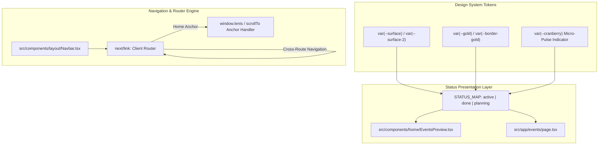

# Site-Wide ESLint Resolution and Brand Styling Alignment

*   **Author:** safwaanshaikhconnect-wq
*   **Status:** Approved
*   **Date:** 2026-11-08

--------------------------------------------------------------------------------

## Overview

This specification directs the clean refactoring of the Rotaract KAHE website to eliminate all 10 site-wide ESLint errors and bring all landing and sub-page components into full compliance with District 3206 editorial guidelines (`AGENTS.md`). The scope covers re-skinning event status badges to Navy (`#050B1A`) and Gold (`#D4A62A`) tokens, removing informal `//` text prefixes from headers, correcting unescaped quote entities, and upgrading navbar navigation to Next.js `<Link>` components to maintain smooth-scrolling client routing.

## The Problem

1. **Brand Token Divergence:** `EventsPreview.tsx` and `src/app/events/page.tsx` use Tailwind `indigo` and `violet` utility classes, violating the project's strict Navy & Gold color specification and anti-slop rules against decorative purple/blue gradient styling.
2. **ESLint JSX Text Node Errors:** `ContactCTA.tsx`, `StatsStrip.tsx`, and `Footer.tsx` render raw `//` text within JSX children, triggering `react/jsx-no-comment-textnodes` failures during CI/build checks.
3. **Unoptimized Internal Routing:** `Navbar.tsx` uses standard HTML `<a>` anchor tags for internal navigation, which triggers Next.js router warnings and can force unnecessary full-document browser reloads instead of fast client transitions.
4. **Build-Breaking Entity Warnings:** `src/app/events/page.tsx` contains unescaped single quotes (`KAHE's`), triggering `react/no-unescaped-entities`.
5. **Dead Imports:** `EventsPreview.tsx` imports an unused `Button` component, triggering `@typescript-eslint/no-unused-vars`.

## Goals

*   **Zero ESLint Errors:** `npm run lint` completes with zero errors and zero warnings across all project directories.
*   **Design Token Compliance:** 100% of event badges across `EventsPreview.tsx` and `app/events/page.tsx` utilize semantic theme variables (`var(--surface)`, `var(--surface-2)`, `var(--gold)`, `var(--cranberry)`).
*   **Clean Accessibility:** Screen readers articulate section headings directly without pronouncing decorative slash punctuation.
*   **Smooth Client Routing:** Internal navbar navigation retains active Lenis and GSAP smooth-scroll states on the home page and leverages Next.js client-side page transitions across sub-routes.

## Non-Goals

*   Modifying data structures, schemas, or event records in `src/lib/data.ts`.
*   Altering Lenis inertia coefficients or GSAP ScrollTrigger timeline curves.
*   Introducing new UI library dependencies or heavy client state stores.

## Critical User Journeys (CUJs)

### CUJ 1: Visitor Inspects Club Events
*   **Given**: A visitor lands on the homepage or navigates to `/events`.
*   **When**: The user scrolls to the events section.
*   **Then**: Status badges display in crisp brand colors: Upcoming events highlight in deep navy with gold typography and a subtle cranberry indicator dot; Completed and Planning events display in muted neutral surfaces. No violet or indigo tints appear.

### CUJ 2: Developer Runs Quality Verification
*   **Given**: A developer or CI workflow executes verification checks.
*   **When**: `npm run lint` and `npm run build` are triggered in the terminal.
*   **Then**: Linter passes cleanly with exit code 0; zero unused variables, unescaped entity warnings, or JSX text node errors are reported.

### CUJ 3: User Navigates via Navigation Bar
*   **Given**: A visitor clicks a link in the desktop header or mobile drawer.
*   **When**: The link is an anchor on the current page (e.g., `/#about`).
*   **Then**: The page smoothly scrolls into view via Lenis without full-page reloads, and the URL updates cleanly.

--------------------------------------------------------------------------------

## Technical Plan (Architecture)

### Architectural Flow & System Interaction



### 1. Status Badge & Card Re-skinning
Both `EventsPreview.tsx` and `src/app/events/page.tsx` will share identical status badge definitions:

*   **Active (Upcoming):**
    *   Class: `bg-[var(--surface-2)] text-[var(--gold)] border-[var(--border-gold)] text-xs font-semibold px-2.5 py-0.5 rounded-full`
    *   Indicator: Embedded 1.5px pulsating cranberry indicator:
        ```tsx
        <span className="w-1.5 h-1.5 rounded-full bg-[var(--cranberry)] mr-1.5 inline-block animate-pulse" />
        ```
*   **Done (Completed):**
    *   Class: `bg-[var(--surface)] text-[var(--muted-foreground)] border-[var(--border)] text-xs font-medium px-2.5 py-0.5 rounded-full`
*   **Planning:**
    *   Class: `bg-[var(--surface)]/60 text-[var(--foreground)]/80 border-[var(--border)] text-xs font-medium px-2.5 py-0.5 rounded-full`
*   **Card Backgrounds:** Remove `glass-card` and indigo border hover classes (`hover:border-indigo-500/30`). Replace with `bg-[var(--surface)] border border-[var(--border)] hover:border-[var(--border-gold)] transition-colors duration-200`.
*   **Section Kicker:** In `EventsPreview.tsx` line 48, replace `text-indigo-400` with `text-[var(--gold)] font-mono text-xs uppercase tracking-widest font-medium`.

### 2. Header Prefix Stripping (Resolving `react/jsx-no-comment-textnodes`)
Strip raw `// ` text node characters across all affected components while preserving high-tracking typography:
*   `src/components/home/ContactCTA.tsx:22`: `// GET INVOLVED` &rarr; `GET INVOLVED`
*   `src/components/home/StatsStrip.tsx:79`: `// 0{i + 1}` &rarr; `0{i + 1}`
*   `src/components/layout/Footer.tsx:34`: `// DISTRICT 3206` &rarr; `DISTRICT 3206`
*   `src/components/home/PhotoMarquee.tsx:81`: `// LIFE AT ROTARACT KAHE` &rarr; `LIFE AT ROTARACT KAHE`
*   `src/app/team/page.tsx:75`: `// {dept}` &rarr; `{dept}`

### 3. Navigation Anchor Normalization (`@next/next/no-html-link-for-pages`)
Refactor `src/components/layout/Navbar.tsx`:
*   Replace standard `<a>` tags on lines 122, 143, 167, and 183 with `<Link href={item.href}>` (and `<Link href="/contact">`).
*   Implement `handleAnchorClick(e: React.MouseEvent<HTMLAnchorElement>, href: string)`:
    *   When navigating to an anchor on the home page (`isHome === true` and `href.startsWith("/#")`), prevent default browser navigation and invoke Lenis:
        ```ts
        const targetId = href.replace("/#", "");
        const targetEl = document.getElementById(targetId);
        if (targetEl && (window as any).lenis) {
          e.preventDefault();
          (window as any).lenis.scrollTo(targetEl, { offset: -64, duration: 1.1 });
        }
        ```
    *   When navigating from a sub-page (e.g., `/events` to `/#about`), permit standard Next.js client-side navigation.

### 4. Syntax & Unused Import Cleanups
*   `src/components/home/EventsPreview.tsx:7`: Delete unused `Button` from `import { Button, buttonVariants } from "@/components/ui/button";`.
*   `src/app/events/page.tsx:50`: Replace `KAHE's` with `KAHE&apos;s` to eliminate `react/no-unescaped-entities`.

--------------------------------------------------------------------------------

## Alternatives Considered

### Alternative A: Escaping `//` in JSX Using Curly Brackets (`{"// GET INVOLVED"}`)

*   **Pros**: Technically silences the ESLint `react/jsx-no-comment-textnodes` rule without altering visual text content.
*   **Cons**: Preserves a developer code-comment trope that conflicts with the editorial Rotaract identity. Introduces unnatural pauses for screen reader assistive devices ("slash slash get involved").
*   **Reason for Rejection**: Rejected by author: Code-comment slashes degrade institutional visual prestige and harm accessibility. Removing the prefix produces cleaner typography and resolves the ESLint infraction at the root.

### Alternative B: Limiting Cleanup Exclusively to `src/components/home`

*   **Pros**: Reduces the count of touched files to three components.
*   **Cons**: Leaves `src/app/events/page.tsx` in a broken lint state with build failures (`react/no-unescaped-entities`) and leaves secondary pages styled with inconsistent indigo tokens.
*   **Reason for Rejection**: Rejected by author: A partial cleanup creates tech debt and leaves CI build checks failing. All 10 site-wide errors must be eliminated in one unified pass.

### Alternative C: Mutating Global Badge Primitives in `src/components/ui/badge.tsx`

*   **Pros**: Automatically propagates styling to all badges application-wide.
*   **Cons**: Overwriting global `badgeVariants` mutates standard design system primitives, which could break future unrelated badge use-cases (e.g., member roles, administrative flags).
*   **Reason for Rejection**: Rejected by author: Event status semantics are domain-specific and should be defined directly within event presentation dictionaries rather than mutating atomic UI primitives.

--------------------------------------------------------------------------------

## Detailed Implementation Plan

The following unified list defines the exact sequence of modifications required across the codebase:

### Phase 1: Linter & Syntax Cleansing (Zero ESLint Failures)

1.  **`src/components/home/EventsPreview.tsx`**:
    *   *Path:* [src/components/home/EventsPreview.tsx](file:///c:/Users/safwa/OneDrive/Documents/Obsidian%20Vault/Dev/rotaract-site/src/components/home/EventsPreview.tsx#L7)
    *   *Action:* Remove `Button` from the import statement on line 7, leaving only `buttonVariants`.
    *   *Rationale:* Resolves `@typescript-eslint/no-unused-vars`.

2.  **`src/app/events/page.tsx`**:
    *   *Path:* [src/app/events/page.tsx](file:///c:/Users/safwa/OneDrive/Documents/Obsidian%20Vault/Dev/rotaract-site/src/app/events/page.tsx#L50)
    *   *Action:* Replace unescaped single quote in `KAHE's` with `KAHE&apos;s` on line 50.
    *   *Rationale:* Resolves `react/no-unescaped-entities` preventing Next.js production builds.

3.  **`src/components/home/ContactCTA.tsx`**:
    *   *Path:* [src/components/home/ContactCTA.tsx](file:///c:/Users/safwa/OneDrive/Documents/Obsidian%20Vault/Dev/rotaract-site/src/components/home/ContactCTA.tsx#L22)
    *   *Action:* Remove `// ` from `// GET INVOLVED` on line 22.
    *   *Rationale:* Resolves `react/jsx-no-comment-textnodes`.

4.  **`src/components/home/StatsStrip.tsx`**:
    *   *Path:* [src/components/home/StatsStrip.tsx](file:///c:/Users/safwa/OneDrive/Documents/Obsidian%20Vault/Dev/rotaract-site/src/components/home/StatsStrip.tsx#L79)
    *   *Action:* Remove `// ` from `// 0{i + 1}` on line 79.
    *   *Rationale:* Resolves `react/jsx-no-comment-textnodes`.

5.  **`src/components/layout/Footer.tsx`**:
    *   *Path:* [src/components/layout/Footer.tsx](file:///c:/Users/safwa/OneDrive/Documents/Obsidian%20Vault/Dev/rotaract-site/src/components/layout/Footer.tsx#L34)
    *   *Action:* Remove `// ` from `// DISTRICT 3206` on line 34.
    *   *Rationale:* Resolves `react/jsx-no-comment-textnodes`.

6.  **`src/components/home/PhotoMarquee.tsx`**:
    *   *Path:* [src/components/home/PhotoMarquee.tsx](file:///c:/Users/safwa/OneDrive/Documents/Obsidian%20Vault/Dev/rotaract-site/src/components/home/PhotoMarquee.tsx#L81)
    *   *Action:* Remove `// ` from `// LIFE AT ROTARACT KAHE` on line 81.
    *   *Rationale:* Resolves `react/jsx-no-comment-textnodes`.

7.  **`src/app/team/page.tsx`**:
    *   *Path:* [src/app/team/page.tsx](file:///c:/Users/safwa/OneDrive/Documents/Obsidian%20Vault/Dev/rotaract-site/src/app/team/page.tsx#L75)
    *   *Action:* Remove `// ` from `// {dept}` on line 75.
    *   *Rationale:* Resolves `react/jsx-no-comment-textnodes`.

### Phase 2: Navigation Normalization (`Navbar.tsx`)

8.  **`src/components/layout/Navbar.tsx`**:
    *   *Path:* [src/components/layout/Navbar.tsx](file:///c:/Users/safwa/OneDrive/Documents/Obsidian%20Vault/Dev/rotaract-site/src/components/layout/Navbar.tsx#L122)
    *   *Action:*
        - Replace desktop navigation `<a>` tags (line 122) with `<Link>`.
        - Replace desktop CTA button `<a>` (line 143) with `<Link href="/contact">`.
        - Replace mobile drawer navigation `<a>` tags (line 167) and CTA button `<a>` (line 183) with `<Link>`.
        - Attach smooth-scroll click interceptor to prevent full page jump when navigating between anchor sections on the root page.
    *   *Rationale:* Eliminates `@next/next/no-html-link-for-pages` and enables client-side Next.js route transitions.

### Phase 3: Brand Token Re-skinning & Anti-Slop Cleansing

9.  **`src/components/home/EventsPreview.tsx`**:
    *   *Path:* [src/components/home/EventsPreview.tsx](file:///c:/Users/safwa/OneDrive/Documents/Obsidian%20Vault/Dev/rotaract-site/src/components/home/EventsPreview.tsx#L10-L29)
    *   *Action:*
        - Update `STATUS_MAP` to replace zinc, indigo, and violet Tailwind classes with Navy (`var(--surface-2)`), Gold (`var(--gold)` / `var(--border-gold)`), and muted surfaces (`var(--surface)` / `var(--muted-foreground)`).
        - Inject cranberry pulsing indicator dot on `active` status.
        - Replace `glass-card` and indigo border hover classes on line 58 with `bg-[var(--surface)] border border-[var(--border)] hover:border-[var(--border-gold)]`.
        - Update kicker typography on line 48 to `text-[var(--gold)] font-mono text-xs uppercase tracking-widest font-medium`.
    *   *Rationale:* Enforces strict adherence to the project's Navy & Gold palette and removes banned glassmorphism styling.

10. **`src/app/events/page.tsx`**:
    *   *Path:* [src/app/events/page.tsx](file:///c:/Users/safwa/OneDrive/Documents/Obsidian%20Vault/Dev/rotaract-site/src/app/events/page.tsx#L12-L27)
    *   *Action:* Synchronize `STATUS_MAP`, card background classes, and category headers with the updated Navy/Gold tokens established in `EventsPreview.tsx`.
    *   *Rationale:* Eliminates visual drift between the home page events preview and the dedicated events directory.

### Phase 4: Drift Report Resolution

11. **`2026-11-08_DRIFT_REPORT.md`**:
    *   *Path:* [2026-11-08_DRIFT_REPORT.md](file:///c:/Users/safwa/OneDrive/Documents/Obsidian%20Vault/Dev/rotaract-site/2026-11-08_DRIFT_REPORT.md)
    *   *Action:* Annotate all reported styling drift and ESLint issues as resolved.
    *   *Rationale:* Keeps architectural documentation synchronized with codebase state.

